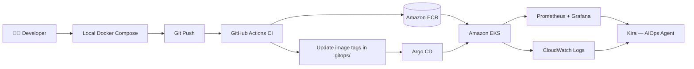
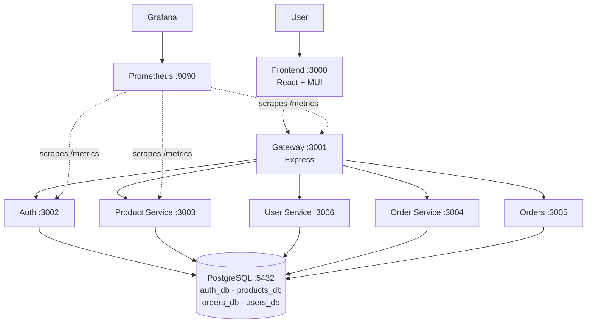

# 🛍️ Boutique — End-to-End DevOps on AWS

**A production-style microservices platform: Terraform → GitHub Actions → ECR → Argo CD (GitOps) → EKS → Prometheus & Grafana → AI-powered incident assistant**


</div>

---

## 📖 Overview

This project takes a luxury-fashion **e-commerce application** built as 6 backend microservices and a React frontend, and runs it the way a real engineering team would: infrastructure defined as code, images built and pushed automatically, deployments driven by Git, and the whole system observable and self-healing.

It also includes **Kira**, an AI SRE assistant built on **AWS Bedrock Agents** that diagnoses incidents by querying CloudWatch Logs, Prometheus metrics, and EKS cluster health.

### ✨ Highlights

| | |
|---|---|
| 🏗️ **Infrastructure as Code** | VPC, EKS, ECR, Argo CD and the monitoring stack provisioned with modular Terraform |
| 🔄 **CI pipeline** | GitHub Actions matrix builds **7 images in parallel**, pushes to ECR tagged with the commit SHA, then commits the new tags back to the manifests |
| 🚀 **GitOps delivery** | Argo CD watches the repo and syncs the cluster automatically, with self-healing |
| 📊 **Observability** | Prometheus scrapes every service via `ServiceMonitor`; a pre-loaded Grafana dashboard ships as a ConfigMap |
| 🤖 **AIOps** | Bedrock Agent + 3 Lambda action groups + Streamlit chat UI for root-cause analysis |
| 🐳 **Local-first** | The whole stack, including Prometheus and Grafana, runs with a single `docker-compose up` |

---

## 📸 Project in Action

### CI/CD pipeline — 7 parallel image builds, then an automatic manifest update

Run completed in **3m 39s**: seven `build-and-push` matrix jobs feed into `update-manifests`, which commits the new image tag back to the repo.


### Container images in Amazon ECR

One private repository per service, all provisioned by Terraform.


Each image is tagged with the Git commit SHA that produced it, so every running pod is traceable back to a commit.


<p align="center">

  &nbsp;&nbsp;&nbsp;
  

</p>

<p align="center">
  <sub><b>Gateway image</b> &nbsp;&nbsp;&nbsp;&nbsp;&nbsp;&nbsp;&nbsp;&nbsp; <b>Frontend image</b></sub>
</p>
 

### GitOps with Argo CD — Synced and Healthy

Argo CD shows every Service mapped to its running Pod, with **auto-sync enabled** and the last sync tied to a Git commit.


### 🩹 Self-healing proof

The `product-service` Deployment was deleted by hand with `kubectl delete`. Argo CD detected the drift from Git and recreated it within seconds, and the application returned to **Synced / Healthy** without any manual intervention.


### Kubernetes on Amazon EKS

EKS node (Kubernetes `v1.34`) running all Boutique workloads. The `boutique-db-restore` pod shows `Completed`, which is the expected state for the one-time database restore Job.


### Observability — Grafana dashboard

The **Boutique Microservices** dashboard has a `Service` selector and panels for request rate, p95/p99 latency, active requests, error rate, Node.js heap memory, and more.


### The application

The storefront with product catalog, filters (price, category, brand, size, colour, rating), stock status, and cart.


---

## 🏛️ Architecture

### End-to-end workflow



### Application architecture



| Service | Port | Role |
|---|---|---|
| Frontend | 3000 | React UI |
| Gateway | 3001 | Routes all client requests to backend services |
| Auth | 3002 | Login and registration |
| Product Service | 3003 | Product catalog and inventory |
| Order Service | 3004 | Cart and checkout |
| Orders | 3005 | Order history and management |
| User Service | 3006 | User profiles and account management |
| PostgreSQL | 5432 | Four databases: `auth_db`, `products_db`, `orders_db`, `users_db` |
| Prometheus | 9090 | Metrics collection |
| Grafana | 8080 (cluster) / 3007 (Compose) | Dashboards |

---

## 🧰 Tech Stack

| Layer | Technologies |
|---|---|
| **Frontend** | React, TypeScript, Material UI, Nginx |
| **Backend** | Node.js, Express, TypeScript, PostgreSQL (`pg`), `prom-client` |
| **Containers** | Docker, Docker Compose |
| **Cloud** | AWS EKS, ECR, VPC, IAM (IRSA), CloudWatch, Lambda, Bedrock |
| **IaC** | Terraform (modular: `vpc`, `eks`, `ecr`, `argocd`) with Helm and Kubernetes providers |
| **CI** | GitHub Actions (matrix build, ECR push, manifest update) |
| **CD / GitOps** | Argo CD, Kustomize |
| **Observability** | Prometheus, Grafana, `kube-prometheus-stack`, Fluent Bit → CloudWatch |
| **AIOps** | AWS Bedrock Agent, Lambda (Python 3.12), Streamlit |
| **AI tooling** | Claude Code with AWS EKS, Terraform and Pricing MCP servers |

---

## 📁 Repository Structure

```
.
├── .github/workflows/
│   └── ci.yml                      # Build → push to ECR → update manifests
├── docs/
│   ├── screenshots/                # Images used in this README
│   ├── part1-beginner-concepts.md  # DevOps fundamentals
│   ├── part1-system-design.md      # 12 system design pillars mapped to this project
│   ├── part2-workflow.md           # End-to-end workflow walkthrough
│   └── claude-setup.md             # Claude Code + MCP server setup
├── gitops/                         # Source of truth for Argo CD
│   ├── argo-cd.yml                 # Argo CD Application
│   ├── kustomization.yml
│   ├── namespace.yml
│   ├── secrets.yml
│   └── k8s/
│       ├── backend/                # Deployments, Services, ServiceMonitor
│       ├── frontend/
│       ├── database/               # StatefulSet, Service, restore Job, SQL dump
│       └── grafana-dashboard.yml   # Dashboard as a ConfigMap
└── projects/
    ├── Infrastructure/             # Terraform: VPC, EKS, ECR, Argo CD, monitoring
    ├── boutique-microservices/     # Application source + docker-compose
    │   ├── backend/services/       # auth, gateway, orders, order-service, product-service, user-service
    │   ├── frontend/               # React app
    │   ├── prometheus/ grafana/    # Local observability config
    │   └── database/               # Init scripts and seed data
    ├── aiops-assistant/            # "Kira" — Bedrock Agent, Lambdas, Streamlit UI
    └── Issues.md                   # Problems hit during the build and how they were fixed
```

---

## 🚀 Getting Started

### Prerequisites

- [Docker Desktop](https://www.docker.com/products/docker-desktop/)
- [Node.js 18+](https://nodejs.org/) (only if running without Docker)
- [AWS CLI](https://docs.aws.amazon.com/cli/latest/userguide/install-cliv2.html), configured with `aws configure`
- [Terraform ≥ 1.5](https://developer.hashicorp.com/terraform/install)
- [kubectl](https://kubernetes.io/docs/tasks/tools/) and [Helm](https://helm.sh/docs/intro/install/)

### 1. Run locally with Docker Compose

```bash
git clone https://github.com/Sanket4404/Devops-Project.git
cd Devops-Project/projects/boutique-microservices
docker-compose -f docker-compose.yml up -d
```

| Service | URL |
|---|---|
| Frontend | http://localhost:3000 |
| Gateway metrics | http://localhost:3001/metrics |
| Prometheus | http://localhost:9090 |
| Grafana | http://localhost:3007 (`admin` / `admin`) |

### 2. Provision AWS infrastructure

```bash
cd projects/Infrastructure
terraform init
terraform plan
terraform apply --auto-approve      # ~15 minutes
```

| Resource | Details |
|---|---|
| VPC | 3 public subnets across `us-east-1a/b/c` |
| EKS | `eks-cluster`, Kubernetes 1.34, OIDC provider enabled |
| Node group | `m7i-flex.large`, 1–2 nodes, on-demand |
| ECR | 7 repositories, one per service |
| Argo CD | Helm release into the `argocd` namespace |
| Prometheus + Grafana | `kube-prometheus-stack` Helm release into `monitoring` |

Connect `kubectl`:

```bash
aws eks update-kubeconfig --region us-east-1 --name eks-cluster
kubectl get nodes
```

### 3. Configure CI

Add these under **Settings → Secrets and variables → Actions**:

| Secret | Value |
|---|---|
| `AWS_ACCESS_KEY_ID` | Access key of an IAM user with ECR access |
| `AWS_SECRET_ACCESS_KEY` | Matching secret key |
| `AWS_REGION` | `us-east-1` |
| `AWS_ACCOUNT_ID` | Your 12-digit account ID (`aws sts get-caller-identity --query Account --output text`) |

Then open **Actions → Boutique CI Pipeline → Run workflow**. The workflow uses `workflow_dispatch` (manual trigger); the pipeline is the one shown in the screenshot above.

### 4. Deploy with GitOps

Point `gitops/argo-cd.yml` at **your** fork (`repoURL`), then:

```bash
kubectl apply -f gitops/argo-cd.yml -n argocd
kubectl get application -n argocd          # expect Synced / Healthy
```

Seed the database once PostgreSQL is `1/1 Ready`:

```bash
kubectl get pods -n boutique -l app=boutique-postgres
kubectl apply -f gitops/k8s/database/restore-job.yml
kubectl logs -n boutique -l job-name=boutique-db-restore
```

To enable self-healing and pruning, set the sync policy in `gitops/argo-cd.yml`:

```yaml
syncPolicy:
  automated:
    prune: true
    selfHeal: true
```

### 5. Access the tools

```bash
kubectl port-forward svc/frontend 3000:3000 -n boutique &
kubectl port-forward svc/gateway 3001:3001 -n boutique &
kubectl port-forward svc/kube-prometheus-stack-prometheus 9090:9090 -n monitoring &
kubectl port-forward svc/kube-prometheus-stack-grafana 8080:80 -n monitoring &
kubectl port-forward svc/argocd-server 8443:443 -n argocd &
```

| Tool | URL | Get the admin password |
|---|---|---|
| Frontend | http://localhost:3000 | — |
| Prometheus | http://localhost:9090 | — |
| Grafana | http://localhost:8080 | `kubectl get secret kube-prometheus-stack-grafana -n monitoring -o jsonpath="{.data.admin-password}" \| base64 --decode` |
| Argo CD | https://localhost:8443 | `kubectl -n argocd get secret argocd-initial-admin-secret -o jsonpath="{.data.password}" \| base64 -d` |

Username for both Grafana and Argo CD is `admin`.

### 6. Tear down

```bash
cd projects/Infrastructure
terraform destroy --auto-approve
```

> 💰 EKS and EC2 resources cost money while running. Destroy the stack when you're done.

---

## 🔁 How the CI/CD flow works

```
workflow_dispatch
      │
      ▼
build-and-push  (matrix: 7 parallel jobs)
  auth · gateway · orders · order-service · product-service · user-service · frontend
  └─ docker build  →  docker push to ECR  (tag = commit SHA)
      │
      ▼
update-manifests
  └─ sed new image tag into gitops/k8s/**
  └─ git commit + push to main
      │
      ▼
Argo CD detects the Git change  →  rolls out new pods to EKS
```

Using the **commit SHA as the image tag** (instead of `latest`) makes every deployment immutable, traceable, and easy to roll back.

---

## 📊 Observability

- Every backend service exposes `/metrics` using `prom-client`.
- A `ServiceMonitor` (labelled `release: kube-prometheus-stack`) tells the Prometheus Operator what to scrape every 15s.
- The Grafana dashboard lives in `gitops/k8s/grafana-dashboard.yml` as a ConfigMap labelled `grafana_dashboard: "1"`. The Grafana sidecar imports it automatically, so there is no manual import step.

**Dashboard panels:** request rate · response time (p95/p99) · active requests · error rate · request rate by service · Node.js heap memory · event loop lag · pod CPU · pod memory · pod restarts · service health · 4xx/5xx breakdown.

**Example PromQL**

```promql
# 95th percentile latency
histogram_quantile(0.95, sum by (le) (rate(http_request_duration_seconds_bucket[5m])))

# 5xx rate per service
sum by (job) (rate(http_requests_total{status_code=~"5.."}[5m]))

# Crash-looping pods
kube_pod_container_status_restarts_total{namespace="boutique"}
```

Optional: forward pod logs to CloudWatch with Fluent Bit. See [`projects/README.md`](projects/README.md#log-forwarding-to-cloudwatch-optional).

---

## 🤖 Kira — AIOps Assistant

Kira is an AI SRE assistant that answers questions like *"Why are we seeing 503 errors in the last hour?"* by investigating real telemetry.

```
Streamlit UI  →  Bedrock Agent (Kira)
                    ├── fetch_logs           → CloudWatch Logs
                    ├── fetch_metrics        → Prometheus
                    └── fetch_service_health → EKS cluster + node groups
```

Kira responds with the root cause, supporting evidence, and recommended fixes. The agent, Lambda functions, IAM roles and OpenAPI schemas are all scripted (`setup-iam.sh`, `deploy.sh`). Full setup guide: [`projects/aiops-assistant/README.md`](projects/aiops-assistant/README.md).

---

## 🧠 Challenges & Lessons Learned

Real problems hit during this build (full write-up in [`projects/Issues.md`](projects/Issues.md)):

| Problem | Root cause | Fix |
|---|---|---|
| `too many pods` when scaling replicas | `t3.medium` caps at 17 pods per node | Moved to a larger instance type with a higher pod limit |
| EBS volume would not attach on EKS | Kubernetes > 1.32 on EKS needs IRSA for the EBS CSI driver | Configured an IRSA role for the EBS CSI driver |
| Database never initialised, so "products page not found" | New EBS volumes contain `lost+found`, so Postgres sees a non-empty directory and skips init scripts | Added a DB-restore **Job**, applied once the Postgres pod is Ready |
| Application metrics missing in Grafana | `ServiceMonitor` and gateway Service were not wired correctly | Added a correct `ServiceMonitor` and updated the gateway Service |

---

## 📚 Documentation

| Doc | What's inside |
|---|---|
| [`projects/README.md`](projects/README.md) | Full deployment guide, from Docker to EKS |
| [`docs/part1-beginner-concepts.md`](docs/part1-beginner-concepts.md) | Git, Linux, Docker, CI/CD, IaC, observability basics |
| [`docs/part1-system-design.md`](docs/part1-system-design.md) | 12 system design pillars, each tied to this project |
| [`docs/part2-workflow.md`](docs/part2-workflow.md) | The full developer-to-production workflow |
| [`docs/claude-setup.md`](docs/claude-setup.md) | Using Claude Code and AWS MCP servers in this project |
| [`projects/Issues.md`](projects/Issues.md) | Troubleshooting log |

---

## 🗺️ Roadmap

- [ ] Replace the plaintext demo credentials in `gitops/secrets.yml` with External Secrets Operator or Sealed Secrets
- [ ] Move CI authentication from long-lived IAM keys to GitHub OIDC
- [ ] Add automated tests and image vulnerability scanning to the CI pipeline
- [ ] Add Horizontal Pod Autoscalers and resource requests/limits
- [ ] Add an Ingress controller with TLS in front of the frontend and gateway
- [ ] Store Terraform state remotely (S3 + DynamoDB locking)

---

## 🙏 Acknowledgements

Built following the **DevOps Practice Guide** series. Thanks to its author for the foundation this project builds on.

---

## 👤 Author

**Sanket** — [@Sanket4404](https://github.com/Sanket4404)

If this project helped you, consider giving it a ⭐

---

## 📄 License

Distributed under the MIT License.
